# VeriPix Diagrams

All diagrams for **VeriPix: Enhanced Framework for Generalizable Synthetic Image Forgery Detection**, written in Mermaid (GitHub renders them automatically). Save as `docs/DIAGRAMS.md`.

> These show the **planned** design. The web app, backend and our own trained model do not exist yet.

## Contents

| # | Diagram | Type |
|---|---|---|
| 1 | Use case | UML use case |
| 2 | System architecture | Architecture |
| 3, 3a | FatFormer pipeline, FAA internals | Model flow |
| 4 | Prediction flow | UML sequence |
| 5 | Code structure | UML class |
| 6 | Research methodology | UML activity |
| 7 | Train/test data flow | Data flow |
| 8 | Prediction history | ER |
| 9 | Prediction request lifecycle | UML state |
| 10 | Model lifecycle | UML state |
| 11 | Prediction scenario | UML communication (collaboration) |
| 12 | Layered pattern | Architectural pattern |
| 13 | Multi-tier pattern | Architectural pattern |
| 14 | Client-Server pattern | Architectural pattern |
| 15 | MVC | Architectural pattern |
| 16 | Pipes and Filters | Architectural pattern |
| 17 | Singleton | Design pattern |
| 18 | Facade | Design pattern |
| 19 | Factory | Design pattern |
| 20 | Repository | Architectural pattern |

---

## 1. Use Case Diagram

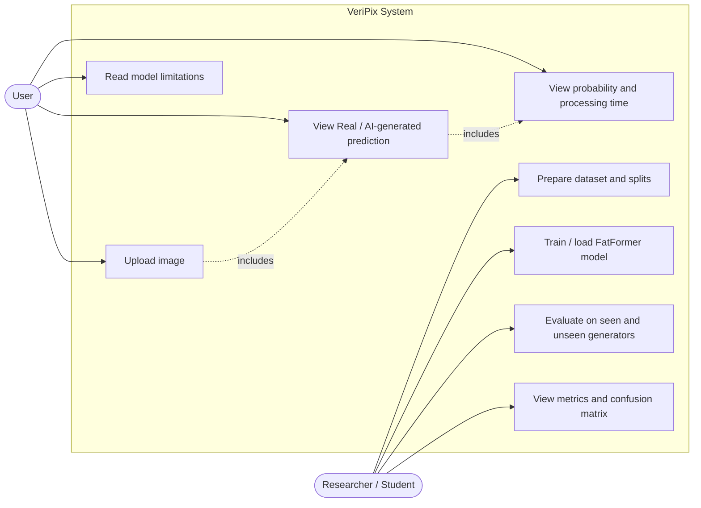

---

## 2. System Architecture (Layered / Component View)

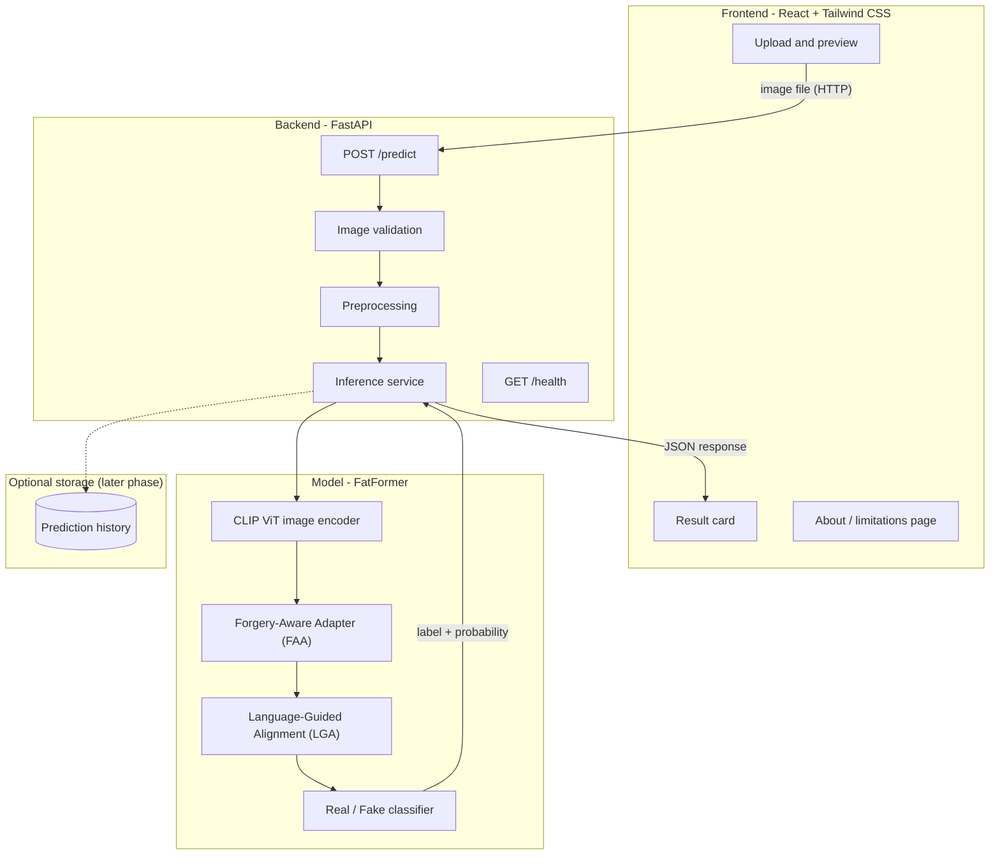

---

## 3. FatFormer Model Pipeline

```mermaid
flowchart LR
    IMG["Input image"] --> PRE["Resize 256, crop 224, normalize"]
    PRE --> PE["Patch embedding"]
    PE --> S1["ViT stage 1"]
    S1 --> F1["FAA"]
    F1 --> S2["ViT stage 2"]
    S2 --> F2["FAA"]
    F2 --> SN["ViT stage N"]
    SN --> FEAT["Image CLS token + patch tokens"]

    subgraph TXT["Text side"]
        P["Learnable context embeddings + class word real/fake"]
        TE["CLIP text encoder"]
        P --> TE
    end

    FEAT --> PBE["Patch-based enhancer"]
    PBE --> P
    TE --> TGI["Text-guided interactor"]
    FEAT --> TGI
    FEAT --> SIM["Cosine similarity with real/fake text embeddings"]
    TGI --> SIM
    SIM --> SOFT["Softmax"]
    SOFT --> OUT["Real or AI-generated"]
```

### 3a. Inside one Forgery-Aware Adapter (FAA)

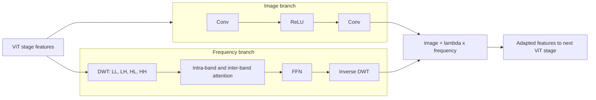

---

## 4. Sequence Diagram: Predicting an Image (web app)

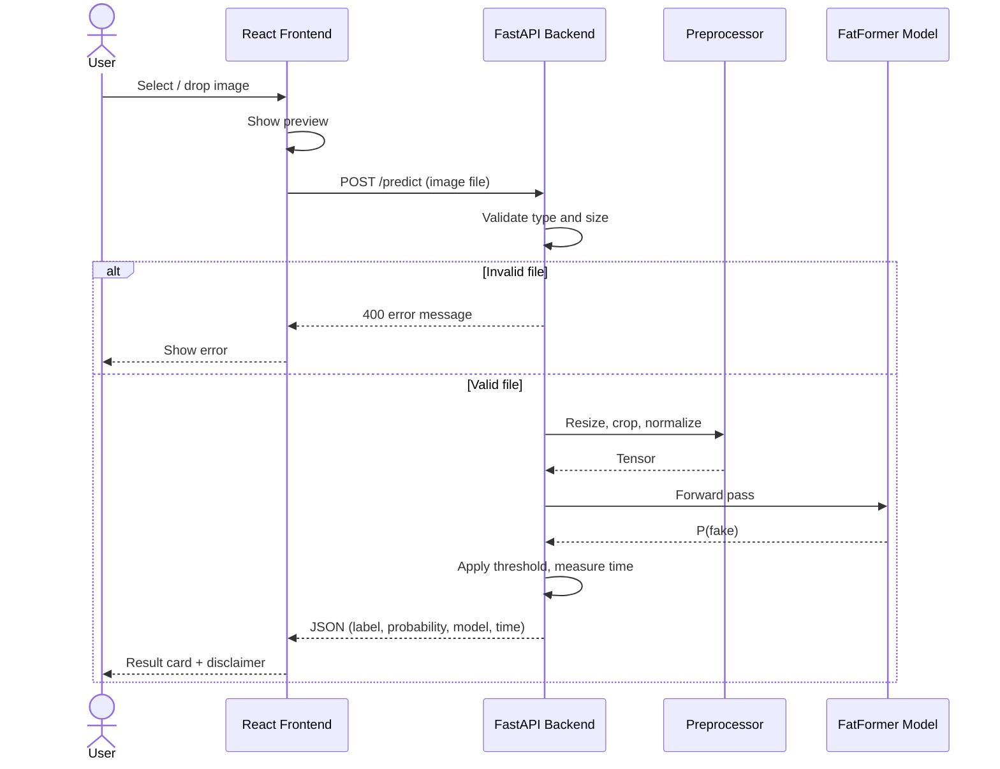

---

## 5. Class Diagram (planned code structure)

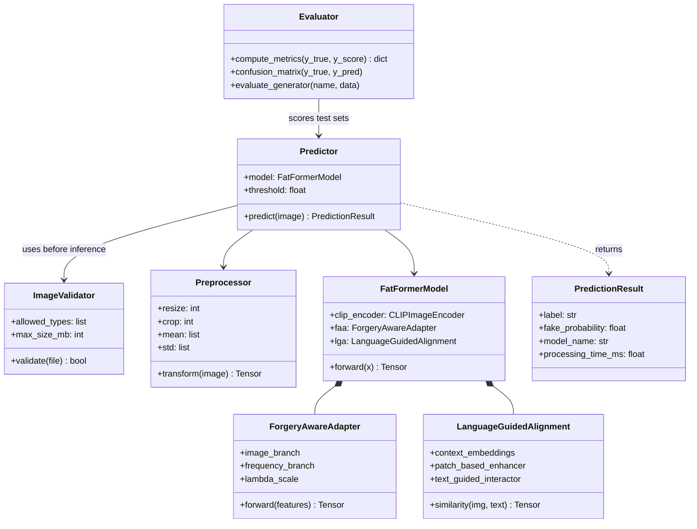

---

## 6. Activity Diagram: Research Methodology

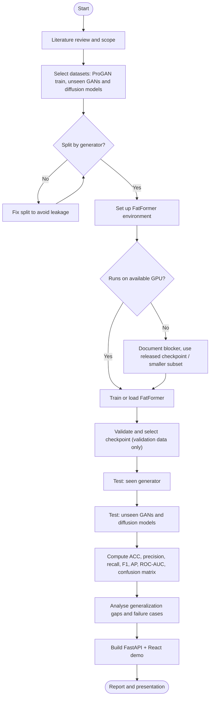

---

## 7. Experiment Data Flow (train / test separation)

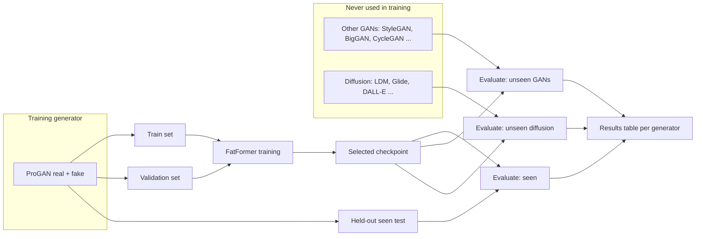

---

## 8. Optional ER Diagram (prediction history, later phase)

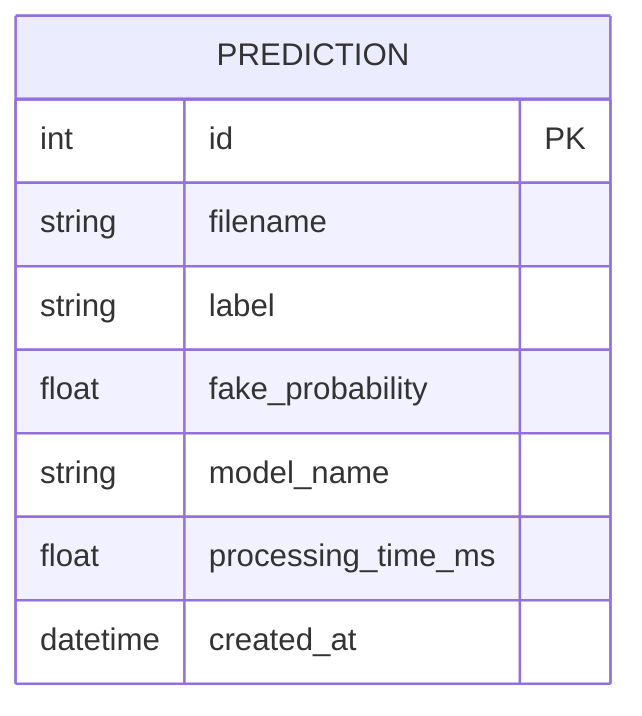

---

## 9. State Diagram: Prediction Request Lifecycle

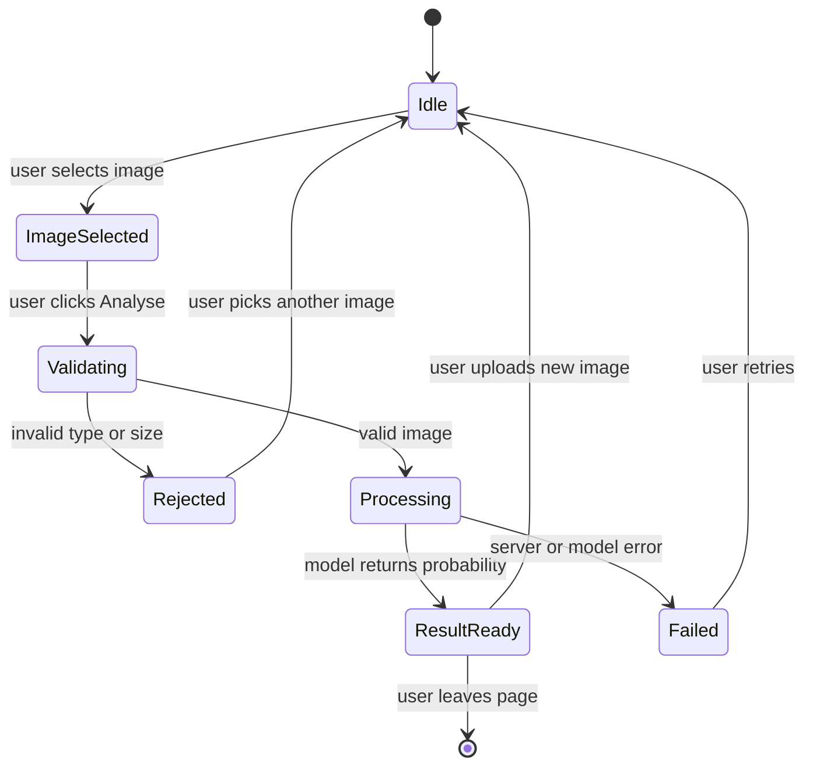

---

## 10. State Diagram: Model Lifecycle (backend)

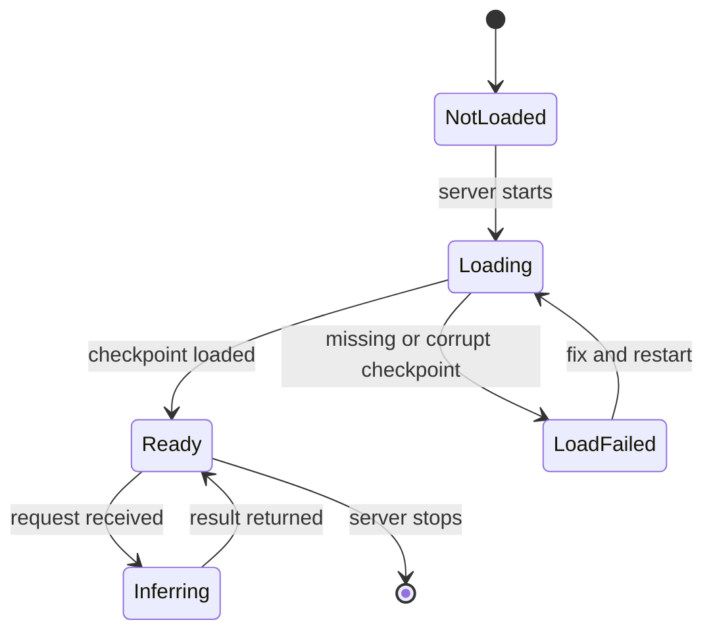

---

## 11. Communication (Collaboration) Diagram: Prediction Scenario

Objects are linked and each message is numbered to show the order. This is the same scenario as the sequence diagram (4), drawn as a communication diagram.

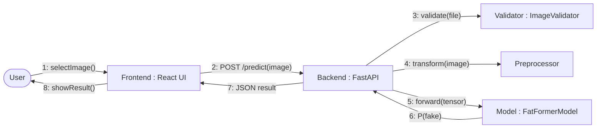

---

## 12. Layered Pattern

Each layer uses only the layer directly below it.

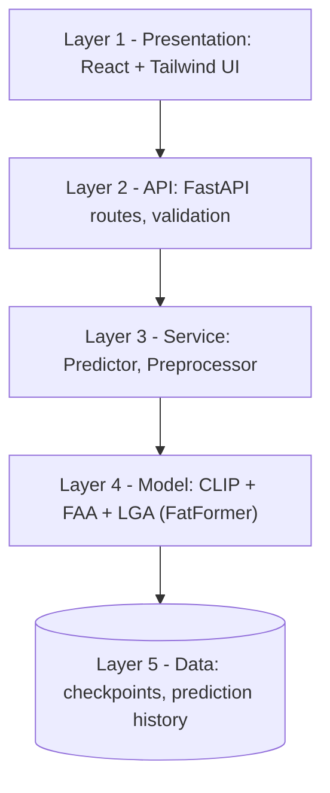

---

## 13. Multi-Tier Pattern

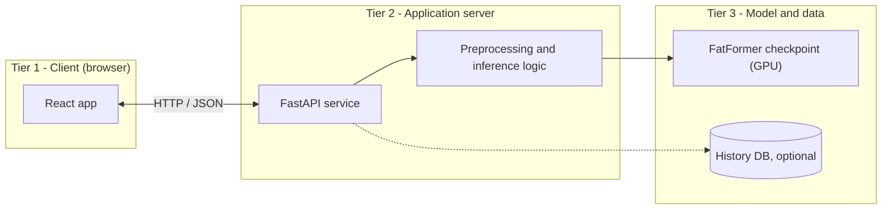

---

## 14. Client-Server Pattern


---

## 15. MVC Pattern

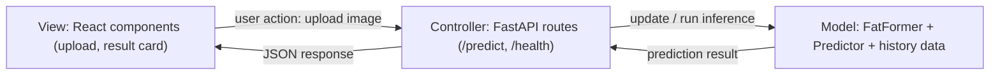

---

## 16. Pipes and Filters Pattern

Each filter does one job. Pipes carry the data between filters.


---

## 17. Singleton Pattern (model loaded once)

Loading a ViT-L/14 model for every request would be too slow, so one shared instance is created at startup.

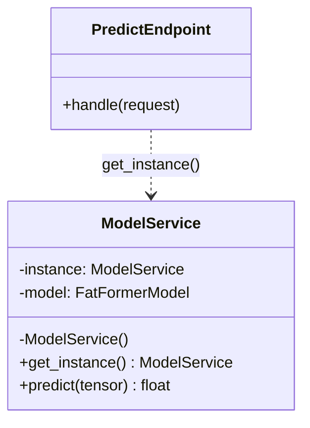

---

## 18. Facade Pattern

`Predictor` gives the API one simple method and hides the subsystems behind it.

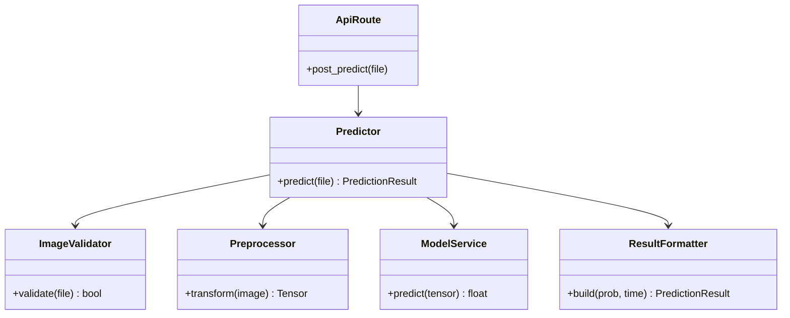

---

## 19. Factory Pattern (creating detectors for comparison)

Useful if VeriPix compares FatFormer with a baseline such as UniFD.

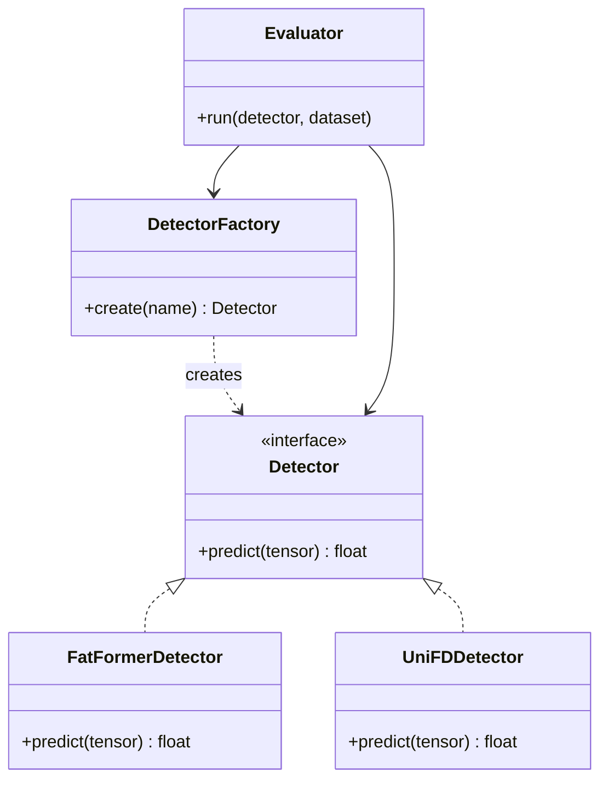

---

## 20. Repository Pattern (prediction history, later phase)

```mermaid
classDiagram
    class PredictionRepository {
        <<interface>>
        +save(result)
        +get_all() list
        +get_by_id(id) PredictionResult
    }
    class SqlitePredictionRepository {
        +save(result)
        +get_all() list
        +get_by_id(id) PredictionResult
    }
    class HistoryService {
        +record(result)
        +list_history() list
    }
    class PredictionResult {
        +label: str
        +fake_probability: float
        +processing_time_ms: float
    }

    PredictionRepository <|.. SqlitePredictionRepository
    HistoryService --> PredictionRepository
    PredictionRepository ..> PredictionResult
    SqlitePredictionRepository --> DataStore
    class DataStore {
        <<database>>
        SQLite file
    }
```

---

### Patterns deliberately not included
Observer, Command, Mediator, Broker, Peer-to-Peer, Publish-Subscribe, Shared Data and Map-Reduce are not used by VeriPix's design, so they are not drawn here. Add one only if the design actually uses it.

