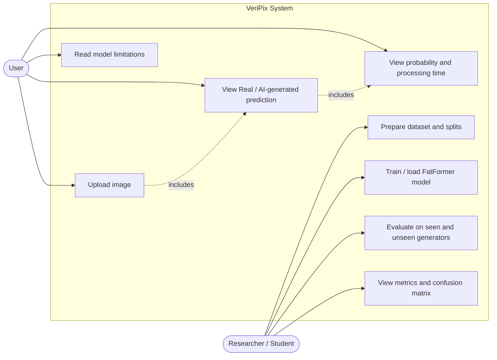
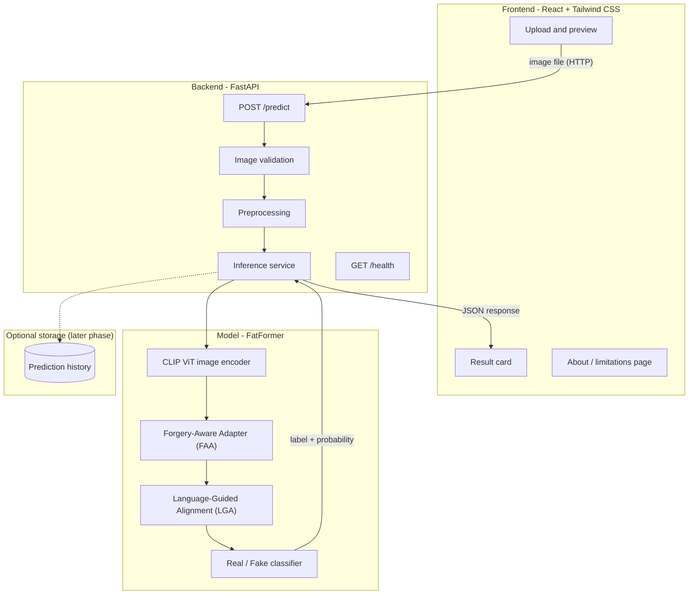
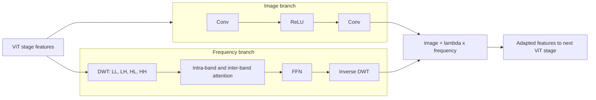
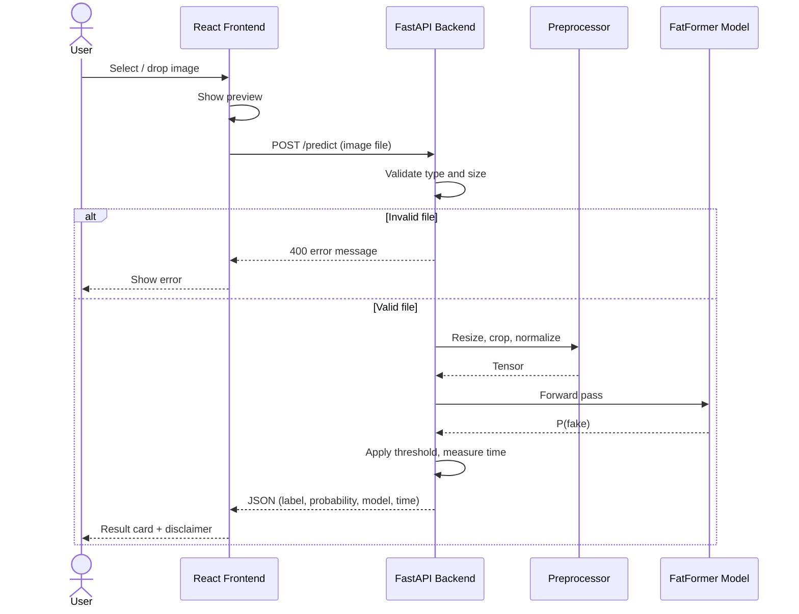
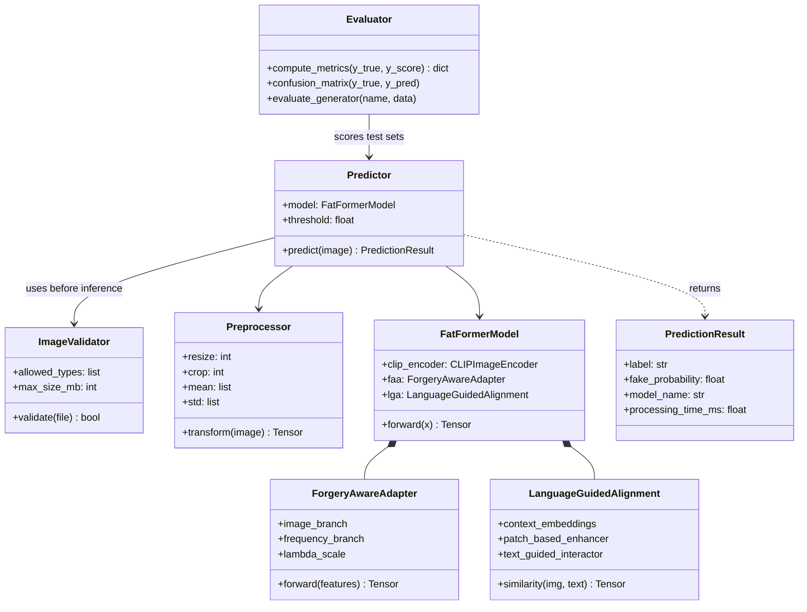
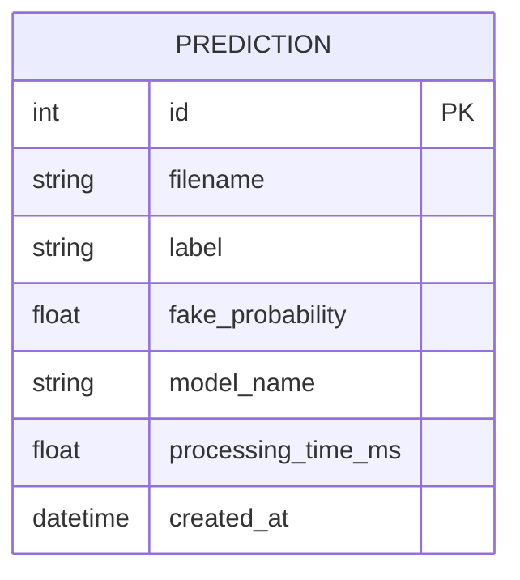
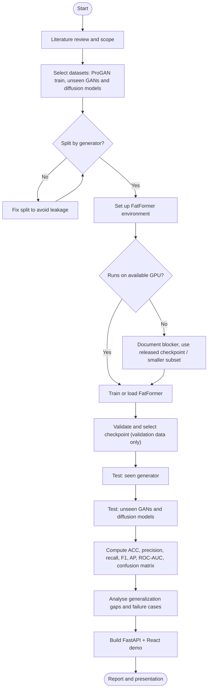
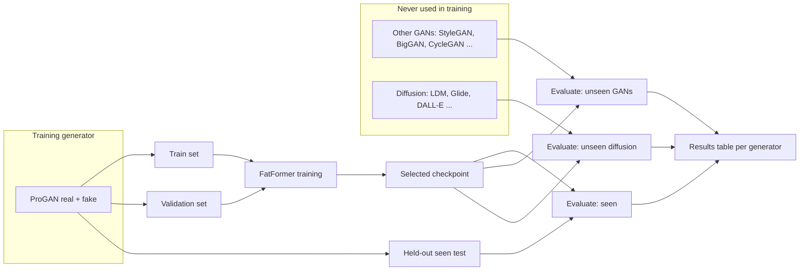

# VeriPix

**Enhanced Framework for Generalizable Synthetic Image Forgery Detection**

*See beyond the pixels.*

VeriPix is a minor research project at NIT Jalandhar (Department of Information Technology). It studies whether a detector trained on one image generator can still detect images from generators it has never seen.

## Team
- Pranshu
- Darshit
- Maninder Saini
- Mentor: Dr. Jaspal Kaur Saini, Assitant Professor (IT Dept)

## Problem
Generative models such as GANs and diffusion models can produce highly realistic images. Many detectors work well on the generators they were trained on but perform worse on unseen ones. VeriPix investigates this generalization gap.

## Scope
VeriPix targets **AI-generated (synthetic) images**. It does not claim to detect copy-move, splicing or retouching.

## Objectives
- Study the FatFormer architecture
- Prepare real and AI-generated image datasets
- Run the published model as a baseline
- Evaluate with accuracy, precision, recall, F1, AP and ROC-AUC
- Test generalization to unseen GANs and diffusion models
- Build a web interface in a later phase

## Baseline: FatFormer
VeriPix builds on **FatFormer** (Liu et al., CVPR 2024), which adapts a CLIP vision transformer with two components:

- **FAA (Forgery-Aware Adapter):** extracts local image artifacts and frequency clues using wavelet (DWT) decomposition, with attention within and across frequency bands.
- **LGA (Language-Guided Alignment):** uses image features and real/fake text prompts with a contrastive objective to improve the learned representation.

Official repository: https://github.com/Michel-liu/FatFormer

---

## System Design

> The diagrams below show the **planned** design. The web app and our own training results do not exist yet; see [Project status](#project-status).

### Use case diagram



### System architecture



### FatFormer model pipeline

```mermaid
flowchart LR
    IMG["Input image"] --> PRE["Resize 256, crop 224, normalize"]
    PRE --> PE["Patch embedding"]
    PE --> S1["ViT stage 1"]
    S1 --> F1["FAA"]
    F1 --> S2["ViT stage 2"]
    S2 --> F2["FAA"]
    F2 --> SN["ViT stage N"]
    SN --> FEAT["Image CLS token + patch tokens"]

    subgraph TXT["Text side"]
        P["Learnable context embeddings + class word real/fake"]
        TE["CLIP text encoder"]
        P --> TE
    end

    FEAT --> PBE["Patch-based enhancer"]
    PBE --> P
    TE --> TGI["Text-guided interactor"]
    FEAT --> TGI
    FEAT --> SIM["Cosine similarity with real/fake text embeddings"]
    TGI --> SIM
    SIM --> SOFT["Softmax"]
    SOFT --> OUT["Real or AI-generated"]
```



### Inside one Forgery-Aware Adapter (FAA)



###  Sequence Diagram: Prediction flow (planned web app)



### Class diagram (planned code structure)



### ER diagram (prediction history, later phase)



All diagrams are also collected in [`docs/DIAGRAMS.md`](docs/DIAGRAMS.md).

---

## Research Methodology

### Activity diagram



### Data flow: train / test separation



## Evaluation
- Metrics: accuracy, precision, recall, F1, AP, ROC-AUC, confusion matrix, inference time
- Label convention: real = 0, fake = 1
- Generators are separated between training and testing, so unseen-generator results are meaningful

## Project status
| Item | Status |
|---|---|
| Literature study | In progress |
| FatFormer environment setup | Planned |
| Baseline inference | Planned |
| Cross-generator evaluation | Planned |
| Training | Planned |
| Web app (FastAPI + React) | Planned |

> Numbers reported in the FatFormer paper belong to its authors, not to VeriPix. Results will be added here only after we reproduce them. "Enhanced" will be claimed only for changes we implement and evaluate.

## Quick start (Kaggle)
```bash
git clone https://github.com/<your-username>/VeriPix.git
cd VeriPix
git clone https://github.com/Michel-liu/FatFormer.git
```
Then follow the FatFormer README for dependencies, the checkpoint and the evaluation command.

## Planned tech stack
Python, PyTorch, CLIP, pytorch_wavelets, scikit-learn, FastAPI, React, Tailwind CSS

## References
- Liu et al., *Forgery-aware Adaptive Transformer for Generalizable Synthetic Image Detection*, CVPR 2024.
- Ojha et al., *Towards Universal Fake Image Detectors that Generalize Across Generative Models*, CVPR 2023.
- Wang et al., *CNN-generated images are surprisingly easy to spot... for now*, CVPR 2020.

